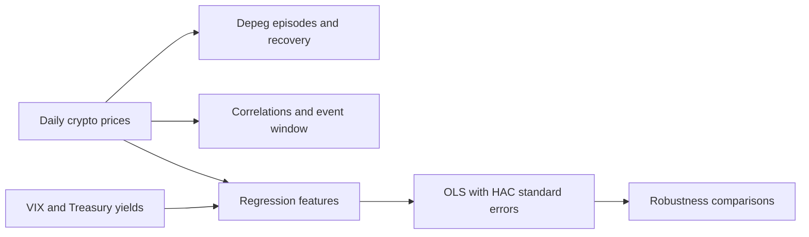

# Stablecoin Depegging, Recovery and Market Stress

Python research into how **USDT, USDC and DAI** deviate from their $1 peg, how quickly they recover, and how these deviations relate to cryptocurrency and traditional market stress.

**Author:** [Renuka Hulsurkar](https://github.com/renukahulsurkar99)

**Project:** Dissertation research, with code organised for reproducibility.

## Research questions

- How do depeg episodes and recovery times change under one-day and two-day confirmation rules?
- How do stablecoin deviation correlations differ between normal and stress days?
- Are absolute peg deviations associated with Bitcoin volatility, VIX and Treasury yield changes?
- How sensitive are the results to calendar alignment and the March 2023 stress window?

## Approach



| Analysis | Method |
| --- | --- |
| Peg deviations | Signed and absolute percentage deviations from $1 |
| Episode detection | Breaches outside $0.995–$1.005, with one-day and two-day recovery confirmation |
| Recovery dynamics | Episode severity, direction, elapsed recovery time and end-of-sample censoring |
| Stress correlations | Compare days when any of the three coins breaches ±0.5% with remaining days |
| March 2023 event window | Daily deviations over seven days before and after 11 March 2023 |
| Regression | OLS with HAC/Newey–West standard errors, using seven observation lags |
| Robustness | Observed-market-day versus full-calendar samples, alternative BTC stress measure and SVB-window exclusions |

## Research observations

The supplied daily sample shows USDC and DAI trading below their peg during the March 2023 episode, while USDT traded above it. The regression specifications have limited explanatory power, so the results are interpreted as associations rather than evidence of causation or a validated prediction strategy.

Recovery results depend on the confirmation rule and treatment of suspected data anomalies. The analysis therefore compares alternative definitions and reports sensitivity to selected dates. See [methodology and limitations](docs/methodology.md).

## Run locally

**Python 3.13** was used for validation.

```bash
git clone https://github.com/renukahulsurkar99/stablecoin-depeg-analysis.git
cd stablecoin-depeg-analysis
python3 -m venv .venv
source .venv/bin/activate
python -m pip install -r requirements.txt
```

On Windows, activate the environment with `.venv\Scripts\activate`.

Supply the two local inputs described in the [data guide](data/README.md), then run:

```bash
python run_analysis.py
```

The runner executes the analyses in dependency order and writes tables and figures to `outputs/`. Input data and generated research outputs are excluded from version control. The original datasets are not redistributed here because their public-sharing permissions have not been established.

With only the cryptocurrency input, run the episode, recovery, correlation and event analyses:

```bash
python run_analysis.py --crypto-only
```

To keep source data and results outside the repository:

```bash
python run_analysis.py --data-dir /path/to/local/data --output-dir /path/to/results
```

No API keys are needed by these scripts. Acquisition of the original source data is a separate step.

## Project files

| File | Purpose |
| --- | --- |
| `detect_depeg_episodes.py` | Detect episodes and compare recovery confirmation rules |
| `analyse_recovery.py` | Summarise severity and recovery and save a scatter plot |
| `analyse_correlations.py` | Compare normal/stress correlations and date-exclusion checks |
| `plot_march_2023_event.py` | Save the March 2023 event-window chart |
| `prepare_regression_data.py` | Align calendars and construct regression features |
| `run_regressions.py` | Fit models, run diagnostics and export comparisons |
| `project_config.py` | Configure paths and validate daily crypto observations |
| `run_analysis.py` | Run the complete workflow or the crypto-only subset |
| `tests/` | Synthetic tests of recovery rules and input validation |

The scripts retain the dissertation's analysis structure. The portfolio preparation adds consistent names, configurable paths, input validation, a runner and focused tests. It also reduces overlapping labels on the recovery chart.

## Validation

```bash
python -m unittest discover -s tests -v
```

Ten synthetic tests cover band boundaries, temporary rebounds, confirmation timing, censored episodes, missing prices, duplicate dates, calendar gaps, nonpositive prices and date sorting. These tests run without the research datasets.

The full workflow was also checked locally against the dissertation inputs. Reproduction details are recorded in [validation notes](docs/validation.md).

## Data and reuse

Consult [data/README.md](data/README.md) before supplying inputs. Source-data licences remain with their respective providers. No open-source code licence has been selected for this repository.
